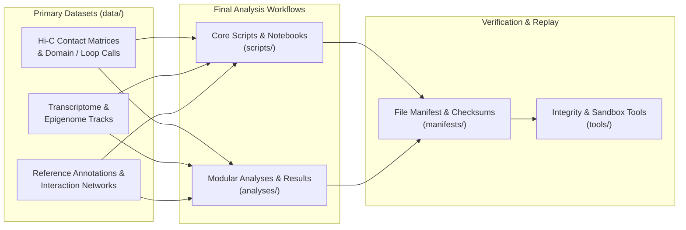

<div align="center">

# 🧬 *Mycobacterium tuberculosis* 3D Genome (`Mtb3DGenome`)

**Data, analysis scripts, and reproducibility workflows supporting the study:**

> *Establishment and Remodeling of the Mycobacterium tuberculosis 3D Genome Orchestrate Context-Dependent Transcriptional Program*

[](#overview)
[](data/)
[](https://www.ncbi.nlm.nih.gov/bioproject/PRJNA1452606)
[](manifests/software_versions.txt)
[](manifests/software_versions.txt)
[](LICENSE)

[🧬 Overview](#overview) •
[🗺️ Workflow](#workflow) •
[🗂️ Structure](#structure) •
[💻 Usage](#usage) •
[📚 Data & Citation](#citation)

<br>


</div>

---

<a id="overview"></a>
## 🧬 Overview

This repository provides the processed Hi-C contact matrices, reference annotations, multi-omics datasets, final analysis scripts, and reproducibility utilities supporting our study of three-dimensional genome architecture, chromatin remodeling, and transcriptional regulation in *Mycobacterium tuberculosis*.

- **Raw sequencing data** are deposited in the NCBI Sequence Read Archive (SRA) under BioProject **[`PRJNA1452606`](https://www.ncbi.nlm.nih.gov/bioproject/PRJNA1452606)**.
- **Streamlined final-version archive:** Raw sequencing files and publication figure binaries are excluded; only the primary processed inputs, final-version analysis code, and verified result tables are retained with SHA-256 integrity checks.

---

<a id="workflow"></a>
## 🗺️ Workflow Overview



---

<a id="structure"></a>
## 🗂️ Repository Structure

```text
.
├── README.md                 # Repository overview and usage guide
├── LICENSE                   # MIT License
├── assets/                   # README banner graphic
├── data/                     # Processed Hi-C matrices, reference files, and multi-omics inputs
│   ├── reference/            # Reference genome sequence and annotations
│   ├── cool_file/            # Balanced contact matrices (.cool / .mcool)
│   ├── hic_file/             # Juicer contact maps (.hic)
│   ├── rep_icedmatrix/       # Biological replicate contact matrices
│   ├── DI_Score_results/     # Directionality index tracks
│   ├── cid_boundary/         # Domain boundary coordinates
│   ├── loops/                # Chromatin loop annotations
│   ├── 3d_model_pdbfile/     # 3D chromosome structure models (PDB)
│   ├── rnaseq/               # Expression matrices and differential expression tables
│   ├── chip_seq_data/        # ChIP-seq signal tracks and peak tables
│   ├── Interaction_network/  # Multi-layer interaction network files
│   └── operon_metadata/      # Operon annotations
├── scripts/                  # Core analysis notebooks and scripts
├── analyses/                 # Final modular computational workflows and result tables
├── methods/                  # High-level computational methods overview
├── references/               # Reference bibliography
├── manifests/                # File inventory, software environment, and SHA-256 checksums
└── tools/                    # Integrity verification and isolated script replay utilities
```

---

<a id="usage"></a>
## 💻 Usage & Verification

### 1. Software Environment

Analyses were executed in standard Python (`≥ 3.9`) and R (`≥ 4.3`) bioinformatics environments. Recorded package versions are listed in [`manifests/software_versions.txt`](manifests/software_versions.txt).

### 2. Verify Repository Integrity

Validate file existence, sizes, and SHA-256 checksums against [`manifests/file_manifest.csv`](manifests/file_manifest.csv):

```bash
python3 tools/validate_manifest.py
```

### 3. Replay Archived Scripts in an Isolated Sandbox

[`tools/run_original.py`](tools/run_original.py) constructs a temporary workspace under `.runtime/` without modifying archived files:

```bash
# View available options
python3 tools/run_original.py --help

# Preview a sandboxed execution command (dry run)
python3 tools/run_original.py <module> <script> --dry-run
```

---

<a id="citation"></a>
## 📚 Data Availability & Citation

- **Raw sequencing data:** NCBI SRA **[`PRJNA1452606`](https://www.ncbi.nlm.nih.gov/bioproject/PRJNA1452606)**
- **Code and processed data:** [github.com/wikk-chy/Mtb3DGenome](https://github.com/wikk-chy/Mtb3DGenome)

If you use the datasets or scripts in this repository, please cite:

> Cai, H., Wei, P., Wang, Y., Xu, W., Chen, X., Chen, Y., Zou, Y., Xu, Y., Cao, X., Dai, J., Reheman, A., & Cao, G. *Establishment and Remodeling of the Mycobacterium tuberculosis 3D Genome Orchestrate Context-Dependent Transcriptional Program.*

<details>
<summary><b>📋 BibTeX Entry</b></summary>

```bibtex
@article{cai_mtb_3d_genome,
  title   = {Establishment and Remodeling of the \textit{Mycobacterium tuberculosis} 3D Genome Orchestrate Context-Dependent Transcriptional Program},
  author  = {Cai, H. and Wei, P. and Wang, Y. and Xu, W. and Chen, X. and Chen, Y. and Zou, Y. and Xu, Y. and Cao, X. and Dai, J. and Reheman, A. and Cao, G.},
  note    = {NCBI SRA: PRJNA1452606; Repository: https://github.com/wikk-chy/Mtb3DGenome}
}
```

</details>

---

## 📄 License

Released under the [MIT License](LICENSE).
