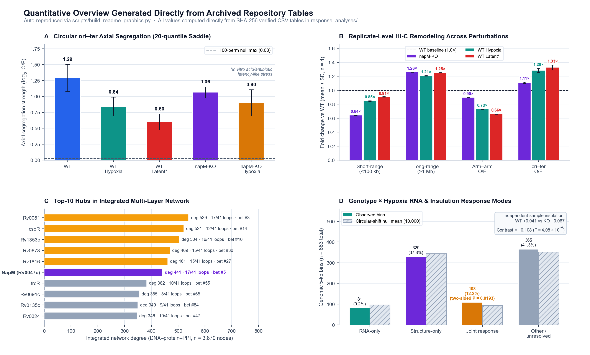
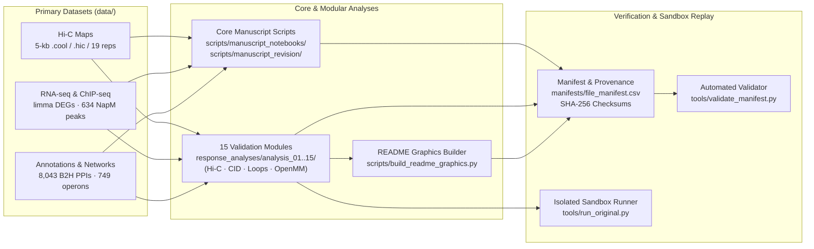

<div align="center">

# 🧬 *Mycobacterium tuberculosis* 3D Genome Architecture & Remodeling (`mtb_hic`)

**Data, analysis scripts, intermediate tables, and reproducibility workflows supporting the study:**

> *Establishment and Remodeling of the Mycobacterium tuberculosis 3D Genome Orchestrate Context-Dependent Transcriptional Program*

[](https://www.ncbi.nlm.nih.gov/datasets/genome/GCF_000195955.2/)
[](data/)
[](https://www.ncbi.nlm.nih.gov/bioproject/PRJNA1452606)
[](manifests/software_versions.txt)
[](manifests/software_versions.txt)
[](response_analyses/analysis_15_openmm_polymer_models/)
[](tools/validate_manifest.py)
[](LICENSE)

[🧬 Overview](#overview) •
[📊 Highlights](#highlights) •
[🗺️ Architecture](#architecture) •
[🗂️ Structure](#structure) •
[🔬 15 Modules](#modules) •
[💻 Workflows](#workflows) •
[✅ Verification](#verification) •
[📚 Citation](#citation)

<br>


</div>

---

<a id="overview"></a>
## 🧬 Overview

This repository provides the processed primary genomic matrices, reference annotations, multi-omics interaction networks, intermediate statistical tables, and analysis/simulation code used to characterize 3D chromosome organization and stress-responsive remodeling in *Mycobacterium tuberculosis* (H37Rv, `4.41 Mb` circular chromosome) across five genetic and physiological states:

| Condition | Genetic / Physiological State | Biological Hi-C Replicates | Matrix Resolution |
|---|---|---:|---|
| **WT** | Exponential-phase wild type | `n = 4` | 5-kb ICE-balanced (merged + replicate) |
| ***napM*-KO** | *Rv0047c* deletion strain | `n = 4` | 5-kb ICE-balanced (merged + replicate) |
| **WT-Hypoxia** | Antibiotic-free sealed-tube hypoxia | `n = 4` | 5-kb ICE-balanced (merged + replicate) |
| ***napM*-KO-Hypoxia** | *Rv0047c* deletion under sealed-tube hypoxia | `n = 3` | 5-kb ICE-balanced (merged + replicate) |
| **WT-Latent** | *In vitro* acid and sub-inhibitory antibiotic-induced latency-like stress | `n = 4` | 5-kb ICE-balanced (merged + replicate) |

- **Raw sequencing data** (Hi-C and RNA-seq FASTQ files) are deposited in the NCBI Sequence Read Archive (SRA) under BioProject **[`PRJNA1452606`](https://www.ncbi.nlm.nih.gov/bioproject/PRJNA1452606)**.
- **Lightweight & verifiable design:** To keep this public repository focused on computational reproducibility, manuscript and figure binary renders (`.pdf`, `.jpg`, `.svg`, `.ai`, `.tex`) are excluded. Every archived dataset, intermediate CSV table, and script is tracked with SHA-256 verification in [`manifests/file_manifest.csv`](manifests/file_manifest.csv); the two overview images in [`assets/`](assets/) are programmatically reproduced directly from those verified tables via [`scripts/build_readme_graphics.py`](scripts/build_readme_graphics.py).

---

<a id="highlights"></a>
## 📊 Quantitative Highlights

<div align="center">
  
  <p><em>Auto-generated directly from the repository's SHA-256 verified CSV tables using <a href="scripts/build_readme_graphics.py"><code>scripts/build_readme_graphics.py</code></a>.</em></p>
</div>

- 🧭 **Circular *ori–ter* Axial Segregation (Not Eukaryotic A/B Compartments):** The leading eigenvector (`PC1`) tracks the first circular Fourier mode (`|r| = 0.97` with `cos(2π·pos/L)`) rather than GC content (`r = −0.02`) or gene density (`r = −0.04`). Mean O/E saddle segregation strength (20 E1-quantile groups, outer-20% corners, leave-one-group-out jackknife *z* tests) declines progressively from **`1.29 log2`** in WT to **`0.84`** under hypoxia (`P = 5.9 × 10⁻⁴`) and **`0.60`** under latency-like stress (`P = 2.6 × 10⁻⁸`), with modest reduction in *napM*-KO (`1.06`, `P = 0.048`; 100-permutation null max `0.03`).
- 🧩 **Chromosomal Interaction Domains (CIDs):** **18** genome-wide CID boundaries identified at 5-kb resolution (100-kb directional window, upstream DI ≤ −2 to downstream DI ≥ +2, minimum CID size 100 kb; within-CID/cross-boundary median contact ratio **`1.102`**, `P = 0.001` vs 1,000 size-matched random partitions; aggregate cross-arm/corner pileup O/E `0.974`, replicates `0.967–0.975`). Genes within the 19 CIDs exhibit modest multi-sample expression coherence (mean pairwise `r = 0.302` vs `0.289`, two-sided empirical `P = 0.045`, 1,000 randomizations).
- ➰ **Chromosight Chromatin Loops:** **41** validated loops (`30–995 kb`, Pearson `r ≥ 0.3`, 5-kb resolution) confirmed by aggregate peak analysis (APA centre O/E **`1.61`** merged; `1.62–1.69` across 4 WT replicates vs `1.01–1.13` distance-matched random pairs), shifted-position controls (`n = 34` finite WT loops vs `n = 35` shifted positions, one-sided Mann–Whitney `P = 2.3 × 10⁻⁵`), and per-loop attenuation in *napM*-KO (median `1.41 → 1.30`, two-sided paired Wilcoxon signed-rank `n = 33`, `P = 0.020`).
- 🕸️ **Multilayer Protein–DNA–PPI Network & NapM (*Rv0047c*):** Integration of **2,992** proteins, **883** 5-kb genomic bins, **8,043** bacterial two-hybrid (B2H) PPIs (Wang *et al.*, 2010), **17,223** protein–DNA interactions (Zeng *et al.*, 2012; Minch *et al.*, 2015), and **41** validated loops. NapM is one of several highly connected nodes (integrated degree rank **#6** [`441`], betweenness rank **#5**, **`17/41`** double-anchor loops, `470` operons, `14` B2H PPI partners). *napM* deletion induces local decompaction with increased global mixing and weakened inter-arm juxtaposition (`<100 kb` contact fraction `0.377 → 0.242`, median contact distance `276 → 515 kb`, distance-normalized secondary-diagonal O/E `2.407 → 2.157`), alongside `822` DEGs (`460` up, `362` down) and disrupted Cooperative Operon Hub (COH) co-expression (`r = 0.9967 → 0.6214`).
- ⚛️ **Stress-Induced Chromosome Remodeling & OpenMM Polymer Modeling:** Both hypoxia and latency-like stress elevate *ori–ter* O/E (`1.29×`, `1.33×`) and long-range (`>1 Mb`) contacts (`1.21×`, `1.25×`) while reducing arm–arm O/E (`0.73×`, `0.66×`) and flattening contact decay `P(s)`. Coarse-grained OpenMM bead–spring ring-polymer simulations evaluate competing folding scenarios (`S1` global collapse, `S2` *ori–ter* tethering, `S3` ring/toroid refolding), providing directional support for S3-like refolding as a population-level working model. Genotype × hypoxia factorial RNA-seq (`730` interaction DEGs) and independent-sample insulation analyses (WT `+0.041` vs KO `−0.067`, contrast `−0.108`, exact permutation `P = 4.08 × 10⁻⁴`) separate RNA-only (`81`), structure-only (`329`), and enriched joint-response loci (`108` vs `93.54` expected, two-sided empirical `P = 0.0193`).

---

<a id="architecture"></a>
## 🗺️ Reproducibility & Data-Flow Architecture



---

<a id="structure"></a>
## 🗂️ Repository Structure

```text
.
├── README.md                          # Project overview, visual summaries, workflows & replay guide
├── LICENSE                            # MIT License
├── assets/                            # Programmatically generated README graphics
│   ├── readme_banner.png              # Study architecture & key quantitative highlights banner
│   └── readme_summary_dashboard.png   # 4-panel quantitative summary plotted from archived CSVs
├── data/                              # Shared primary processed datasets & genome reference
│   ├── reference/                     # genome.fa, genome.fa.fai, annotation.gtf
│   ├── cool_file/                     # Merged 5-kb ICE-balanced matrices (.cool / .mcool, 5 conditions)
│   ├── hic_file/                      # Juicer .hic contact maps (5 conditions)
│   ├── rep_icedmatrix/                # 19 independent replicate 5-kb ICE-balanced contact matrices
│   ├── DI_Score_results/              # Genome-wide directionality index (DI) scores (5 conditions)
│   ├── cid_boundary/                  # CID boundary coordinates (BED, 5 conditions)
│   ├── loops/                         # Chromosight & HiCCUPS loop calls + recalling summary
│   ├── 3d_model_pdbfile/              # Population-averaged LorDG 3D chromosome models (PDB)
│   ├── rnaseq/                        # Merged RNA-seq count matrix & limma DEG tables
│   ├── chip_seq_data/                 # NapM (Rv0047c) ChIP-seq bedgraph, bigwig & published peak tables
│   ├── Interaction_network/           # Multilayer network nodes & edges (PPI, PDI, DNA–DNA)
│   └── operon_metadata/               # 749 annotated operons and 5-kb bin coverage
├── scripts/
│   ├── build_readme_graphics.py       # Reproduces assets/readme_*.png directly from archived CSV tables
│   ├── manuscript_notebooks/          # Original 17 Jupyter/R/Rmd analysis scripts
│   └── manuscript_revision/           # Updated manuscript analysis scripts (18-boundary Fig. 1f & Fig. 2a–b)
├── response_analyses/                 # 15 modular validation & revision analyses (code, data, tables, notes)
│   ├── analysis_01_* .. analysis_15_* # Self-contained modules aligned with final submission analyses
│   └── manuscript_updated_results/    # Updated intermediate CSVs/logs for manuscript Fig. 1f & Fig. 2a–b
├── methods/
│   ├── Analysis_Methods.md            # Detailed computational & statistical methods
│   └── Revision_Update_Summary.md     # Complete 15-module index and methodological updates
├── references/                        # Full Markdown and BibTeX references
├── manifests/
│   ├── analysis_lineage.csv           # Module-level lineage summary
│   ├── file_manifest.csv              # Complete file inventory with source provenance, bytes, and SHA-256
│   ├── software_versions.txt          # Recorded Python/R/CLI environment versions
│   └── validation_report.json         # Latest automated integrity verification report
└── tools/
    ├── validate_manifest.py           # Verifies existence, byte size, SHA-256, exclusions, and coverage
    └── run_original.py                # Replays any archived script in an isolated `.runtime/` sandbox
```

---

<a id="modules"></a>
## 🔬 Modular Validation & Revision Analyses (`response_analyses/`)

| Module | Directory | Scope | Archived Assets |
|---|---|---|---|
| **01** | [`analysis_01_napm_anchor_integration/`](response_analyses/analysis_01_napm_anchor_integration/) | NapM occupancy does not predict uniform local changes but is enriched at chromatin-loop anchors | `63` code · `89` data · `237` tables |
| **02** | [`analysis_02_hypoxia_factorial_integration/`](response_analyses/analysis_02_hypoxia_factorial_integration/) | NapM deletion produces distinct and partially overlapping RNA and insulation responses to hypoxia | `23` code · `6` data · `68` tables |
| **03** | [`analysis_03_network_centrality_hubs/`](response_analyses/analysis_03_network_centrality_hubs/) | NapM (*Rv0047c*) is one of several highly connected nodes in the integrated network | `2` code · `0` data · `4` tables |
| **04** | [`analysis_04_napm_ko_go_kegg_enrichment/`](response_analyses/analysis_04_napm_ko_go_kegg_enrichment/) | GO and KEGG enrichment of differentially expressed genes in *napM*-KO versus WT cells | `4` code · `4` data · `8` tables |
| **05** | [`analysis_05_stress_spatial_polymer_evaluation/`](response_analyses/analysis_05_stress_spatial_polymer_evaluation/) | Spatially non-uniform stress remodelling and polymer-model evaluation | `1` code · `0` data · `0` tables |
| **06** | [`analysis_06_napm_expression_hypoxia_dependence/`](response_analyses/analysis_06_napm_expression_hypoxia_dependence/) | NapM expression, co-regulated architectural proteins and genotype-dependent chromosome remodelling under stress | `20` code · `3` data · `113` tables |
| **07** | [`analysis_07_napm_binding_mechanism_ppi/`](response_analyses/analysis_07_napm_binding_mechanism_ppi/) | Genomic occupancy, transcriptional decoupling, structural associations and protein-interaction context of NapM | `15` code · `5` data · `19` tables |
| **08** | [`analysis_08_pilot_ter_fish_clumping/`](response_analyses/analysis_08_pilot_ter_fish_clumping/) | Pilot *ter*-probe FISH across four *M. tuberculosis* biological replicates illustrates pronounced cell clumping | `1` code · `0` data · `0` tables |
| **09** | [`analysis_09_latency_like_stress_crossvalidation/`](response_analyses/analysis_09_latency_like_stress_crossvalidation/) | Mixed DNA-damage/ROS signatures and shared stress responses in acid/antibiotic-induced latency-like stress versus antibiotic-free hypoxia | `6` code · `1` data · `8` tables |
| **10** | [`analysis_10_circular_eigenvector_saddle/`](response_analyses/analysis_10_circular_eigenvector_saddle/) | Controls and interpretation of chromosome-scale segregation in *M. tuberculosis* | `15` code · `30` data · `16` tables |
| **11** | [`analysis_11_cid_directionality_validation/`](response_analyses/analysis_11_cid_directionality_validation/) | Identification and validation of chromosomal interaction domains (CIDs) using all 18 DI-defined boundaries | `5` code · `0` data · `6` tables |
| **12** | [`analysis_12_chromosight_loop_validation/`](response_analyses/analysis_12_chromosight_loop_validation/) | Validation of Chromosight-called loops in *M. tuberculosis* Hi-C | `15` code · `4` data · `53` tables |
| **13** | [`analysis_13_wt_ko_compaction_metrics/`](response_analyses/analysis_13_wt_ko_compaction_metrics/) | Quantitative comparison of wild-type and *napM*-KO chromosome organization | `7` code · `0` data · `17` tables |
| **14** | [`analysis_14_stress_oriter_experiments/`](response_analyses/analysis_14_stress_oriter_experiments/) | Joint Hi-C signatures are consistent with ring-like chromosome refolding and *ori–ter* apposition under stress | `3` code · `0` data · `3` tables |
| **15** | [`analysis_15_openmm_polymer_models/`](response_analyses/analysis_15_openmm_polymer_models/) | Polymer modelling distinguishes candidate mechanisms of stress-induced chromosome reorganization | `14` code · `1` data · `72` tables |

---

<a id="workflows"></a>
## 💻 Core Manuscript Workflows (`scripts/`)

| Analysis | Script / Module | Primary Inputs |
|---|---|---|
| Differential Hi-C contact maps | [`hicdiff.ipynb`](scripts/manuscript_notebooks/hicdiff.ipynb), [`matrix_plot.ipynb`](scripts/manuscript_notebooks/matrix_plot.ipynb) | `data/hic_file/`, `data/cool_file/` |
| Circular eigenvector & saddle segregation | [`analysis_10_circular_eigenvector_saddle/`](response_analyses/analysis_10_circular_eigenvector_saddle/) | `data/cool_file/`, `data/rep_icedmatrix/` |
| 18-boundary CID calling & Fig. 1f co-expression | [`recalculate_fig1f_cid_coexpression.py`](scripts/manuscript_revision/docx_latex_conversion/recalculate_fig1f_cid_coexpression.py), [`analysis_11_cid_directionality_validation/`](response_analyses/analysis_11_cid_directionality_validation/) | `data/DI_Score_results/`, `data/rnaseq/` |
| Chromosight loop calling & APA validation | [`analysis_12_chromosight_loop_validation/`](response_analyses/analysis_12_chromosight_loop_validation/) | `data/cool_file/`, `data/rep_icedmatrix/`, `data/loops/` |
| Multi-layer network & 18-boundary Fig. 2a–b | [`network_formation.ipynb`](scripts/manuscript_notebooks/network_formation.ipynb), [`redraw_fig2ab_networks_18_boundaries.py`](scripts/manuscript_revision/docx_latex_conversion/redraw_fig2ab_networks_18_boundaries.py) | `data/Interaction_network/`, `data/loops/` |
| Operon hubs (COHs), Shannon entropy & Moran's *I* | [`operon-select_entropymoran's.ipynb`](scripts/manuscript_notebooks/operon-select_entropymoran's.ipynb), [`moran's_shannon.ipynb`](scripts/manuscript_notebooks/moran's_shannon.ipynb) | `data/operon_metadata/`, `data/DI_Score_results/` |
| Exploratory SVD projection & Kabsch RMSD | [`napmkolatentpre_comparedrsmd.ipynb`](scripts/manuscript_notebooks/napmkolatentpre_comparedrsmd.ipynb) | `data/cool_file/`, `data/3d_model_pdbfile/` |
| NapM (*Rv0047c*) cross-species homology | [`homologous.ipynb`](scripts/manuscript_notebooks/homologous.ipynb) | OrthoDB v11 group `2374094at2` (`2,455` orthologs / `2,348` species) |
| Bulk RNA-seq, GO/KEGG & ChIP–RNA integration | [`bulk RNA.Rmd`](scripts/manuscript_notebooks/bulk%20RNA.Rmd), [`go_and_kegg.R`](scripts/manuscript_notebooks/go_and_kegg.R), [`analysis_04_napm_ko_go_kegg_enrichment/`](response_analyses/analysis_04_napm_ko_go_kegg_enrichment/) | `data/rnaseq/`, `data/chip_seq_data/` |
| OpenMM bead–spring ring-polymer simulations | [`analysis_15_openmm_polymer_models/`](response_analyses/analysis_15_openmm_polymer_models/) | `data/rep_icedmatrix/` |
| README banner & quantitative dashboard | [`build_readme_graphics.py`](scripts/build_readme_graphics.py) | Verified CSVs in `response_analyses/` |

---

<a id="verification"></a>
## ✅ Integrity Verification & Isolated Script Replay

### 1. Validate Repository Integrity (SHA-256 & Provenance)

```bash
python3 tools/validate_manifest.py
```

### 2. Regenerate README Summary Graphics from Archived CSV Tables

```bash
python3 scripts/build_readme_graphics.py
```

### 3. Replay Any Archived Script in an Isolated Sandbox

[`tools/run_original.py`](tools/run_original.py) reconstructs the virtual project tree inside `.runtime/<target>/project` by symlinking `data/` and intermediate inputs without modifying any archived file:

```bash
# Inspect path-adapted replay command (dry run)
python3 tools/run_original.py 3 02_build_R2_fig3_network_hubs.py --dry-run
python3 tools/run_original.py 6 05_build_R2_fig6_napm_dependence.py --dry-run
python3 tools/run_original.py 9 08_build_R2_fig9_antibiotic_nrp.py --dry-run
python3 tools/run_original.py manuscript recalculate_fig1f_cid_coexpression.py --dry-run
```

Remove `--dry-run` after installing the software dependencies recorded in [`manifests/software_versions.txt`](manifests/software_versions.txt) (`Python ≥ 3.9` with `cooler`, `cooltools`, `chromosight`, `numpy`, `pandas`, `scipy`, `matplotlib`, `seaborn`, `networkx`, `openmm`; `R ≥ 4.3` with `limma`, `edgeR`, `clusterProfiler`).

---

<a id="citation"></a>
## 📚 Data Availability & Citation

- **Raw sequencing data (Hi-C & RNA-seq):** NCBI SRA **[`PRJNA1452606`](https://www.ncbi.nlm.nih.gov/bioproject/PRJNA1452606)**
- **Processed Hi-C matrices, intermediate tables & code:** [github.com/wikk-chy/mtb_hic](https://github.com/wikk-chy/mtb_hic)

If you use these datasets, tables, or scripts in your research, please cite:

> Cai, H., Wei, P., Wang, Y., Xu, W., Chen, X., Chen, Y., Zou, Y., Xu, Y., Cao, X., Reheman, A., & Cao, G. *Establishment and Remodeling of the Mycobacterium tuberculosis 3D Genome Orchestrate Context-Dependent Transcriptional Program.*

<details>
<summary><b>📋 BibTeX Entry</b></summary>

```bibtex
@article{cai_mtb_hic_3d_genome,
  title   = {Establishment and Remodeling of the \textit{Mycobacterium tuberculosis} 3D Genome Orchestrate Context-Dependent Transcriptional Program},
  author  = {Cai, H. and Wei, P. and Wang, Y. and Xu, W. and Chen, X. and Chen, Y. and Zou, Y. and Xu, Y. and Cao, X. and Reheman, A. and Cao, G.},
  note    = {NCBI SRA: PRJNA1452606; Code and processed matrices: https://github.com/wikk-chy/mtb_hic}
}
```

</details>

---

## 📄 License

Released under the [MIT License](LICENSE).
