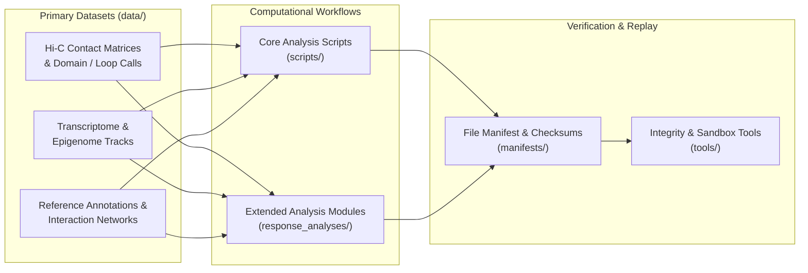

<div align="center">

# 🧬 *Mycobacterium tuberculosis* 3D Genome (`mtb_hic`)

**Data, analysis scripts, and reproducibility workflows supporting the study:**

> *Establishment and Remodeling of the Mycobacterium tuberculosis 3D Genome Orchestrate Context-Dependent Transcriptional Program*

[](https://github.com/wikk-chy/mtb_hic)
[](data/)
[](https://www.ncbi.nlm.nih.gov/bioproject/PRJNA1452606)
[](manifests/software_versions.txt)
[](manifests/software_versions.txt)
[](LICENSE)

[🧬 Overview](#overview) •
[🗺️ Workflow](#workflow) •
[🗂️ Structure](#structure) •
[💻 Usage](#usage) •
[📚 Data & Citation](#citation)

<br>


</div>

---

<a id="overview"></a>
## 🧬 Overview

This repository hosts the processed Hi-C contact matrices, reference annotations, multi-omics datasets, analysis scripts, and reproducibility utilities accompanying our study on three-dimensional genome architecture, chromatin remodeling, and transcriptional regulation in *Mycobacterium tuberculosis*.

- **Raw sequencing data** are deposited in the NCBI Sequence Read Archive (SRA) under BioProject **[`PRJNA1452606`](https://www.ncbi.nlm.nih.gov/bioproject/PRJNA1452606)**.
- **Lightweight archival design:** Raw sequencing files and publication figure renders are excluded; processed matrices, intermediate tables, and analysis scripts are preserved with automated SHA-256 integrity verification.

---

<a id="workflow"></a>
## 🗺️ Workflow Overview



---

<a id="structure"></a>
## 🗂️ Repository Structure

```text
.
├── README.md                 # Repository overview and usage guide
├── LICENSE                   # MIT License
├── assets/                   # README banner graphic
├── data/                     # Processed Hi-C matrices, reference files, and multi-omics inputs
│   ├── reference/            # Reference genome sequence and annotations
│   ├── cool_file/            # Balanced contact matrices (.cool / .mcool)
│   ├── hic_file/             # Juicer contact maps (.hic)
│   ├── rep_icedmatrix/       # Biological replicate contact matrices
│   ├── DI_Score_results/     # Directionality index tracks
│   ├── cid_boundary/         # Domain boundary coordinates
│   ├── loops/                # Chromatin loop annotations
│   ├── 3d_model_pdbfile/     # 3D chromosome structure models (PDB)
│   ├── rnaseq/               # Expression matrices and differential expression tables
│   ├── chip_seq_data/        # ChIP-seq signal tracks and peak tables
│   ├── Interaction_network/  # Multi-layer interaction network files
│   └── operon_metadata/      # Operon annotations
├── scripts/                  # Core analysis notebooks and scripts
├── response_analyses/        # Modular extended analysis code and intermediate tables
├── methods/                  # Computational method notes
├── references/               # Reference bibliography
├── manifests/                # File inventory, software environment, and SHA-256 checksums
└── tools/                    # Integrity verification and isolated script replay utilities
```

---

<a id="usage"></a>
## 💻 Usage & Verification

### 1. Software Environment

Analyses were run in standard Python (`≥ 3.9`) and R (`≥ 4.3`) bioinformatics environments. Recorded package versions are listed in [`manifests/software_versions.txt`](manifests/software_versions.txt).

### 2. Verify Repository Integrity

Check file existence, sizes, and SHA-256 checksums against [`manifests/file_manifest.csv`](manifests/file_manifest.csv):

```bash
python3 tools/validate_manifest.py
```

### 3. Replay Archived Scripts in an Isolated Sandbox

[`tools/run_original.py`](tools/run_original.py) sets up a temporary workspace under `.runtime/` without modifying archived files:

```bash
# View available options
python3 tools/run_original.py --help

# Preview a sandboxed execution command (dry run)
python3 tools/run_original.py <module> <script> --dry-run
```

---

<a id="citation"></a>
## 📚 Data Availability & Citation

- **Raw sequencing data:** NCBI SRA **[`PRJNA1452606`](https://www.ncbi.nlm.nih.gov/bioproject/PRJNA1452606)**
- **Code and processed data:** [github.com/wikk-chy/mtb_hic](https://github.com/wikk-chy/mtb_hic)

If you use the datasets or scripts in this repository, please cite:

> Cai, H., Wei, P., Wang, Y., Xu, W., Chen, X., Chen, Y., Zou, Y., Xu, Y., Cao, X., Reheman, A., & Cao, G. *Establishment and Remodeling of the Mycobacterium tuberculosis 3D Genome Orchestrate Context-Dependent Transcriptional Program.*

<details>
<summary><b>📋 BibTeX Entry</b></summary>

```bibtex
@article{cai_mtb_hic_3d_genome,
  title   = {Establishment and Remodeling of the \textit{Mycobacterium tuberculosis} 3D Genome Orchestrate Context-Dependent Transcriptional Program},
  author  = {Cai, H. and Wei, P. and Wang, Y. and Xu, W. and Chen, X. and Chen, Y. and Zou, Y. and Xu, Y. and Cao, X. and Reheman, A. and Cao, G.},
  note    = {NCBI SRA: PRJNA1452606; Repository: https://github.com/wikk-chy/mtb_hic}
}
```

</details>

---

## 📄 License

Released under the [MIT License](LICENSE).
